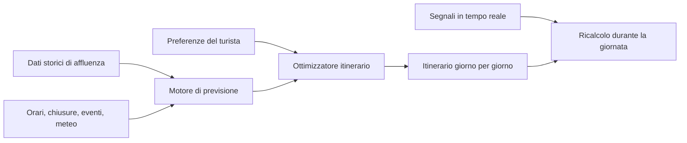
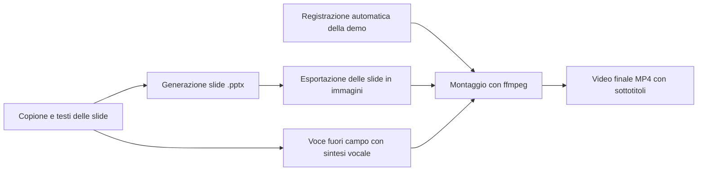

# RomaFlow
### Roma al momento giusto. Il tuo itinerario a Roma, costruito sui flussi reali di persone

> **One-liner:** un'app che conosce in anticipo quando il Colosseo, la Fontana di Trevi o i Musei Vaticani saranno affollati, e costruisce per te l'itinerario che ti fa vedere di più facendo meno fila.

---

## 1. Il problema

Roma è una delle città più visitate al mondo, ma visitarla bene è difficile.

- **Il tempo si perde in coda, non davanti ai monumenti.** Un turista medio resta a Roma pochi giorni e ne passa una parte consistente in fila o tra la folla, spesso negli stessi luoghi alla stessa ora degli altri.
- **Tutti seguono lo stesso copione.** Guide, blog e itinerari "Roma in 3 giorni" mandano le persone negli stessi posti negli stessi orari, alimentando i picchi di affollamento.
- **Le informazioni ci sono, ma sono sparse.** Orari, prenotazioni obbligatorie, giorni di chiusura, eventi, meteo e affollamento sono distribuiti su decine di siti diversi. Nessuno li mette insieme per decidere *quando* andare *dove*.
- **Le app esistenti dicono cosa vedere, non quando.** Mappe e guide indicano i luoghi e il percorso, ma non ottimizzano l'ordine della visita rispetto alla folla prevista.
- **Il sovraffollamento danneggia anche la città.** Concentrazioni eccessive in pochi punti peggiorano l'esperienza del visitatore, la vivibilità per i residenti e la conservazione del patrimonio.

**In sintesi:** il turista ha poco tempo, la città ha troppa gente negli stessi posti alle stesse ore, e manca uno strumento che usi i dati per distribuire meglio le visite.

---

## 2. La soluzione

**RomaFlow** è un pianificatore di viaggio intelligente che:

1. **Conosce i flussi storici** di monumenti, musei, piazze e luoghi di interesse: per ogni luogo, quanto è affollato per giorno della settimana, fascia oraria, stagione e in presenza di eventi.
2. **Chiede al turista poche cose:** date del viaggio, dove alloggia, cosa vuole assolutamente vedere, ritmo preferito (rilassato o intenso), interessi (arte, storia antica, cibo, quartieri autentici).
3. **Genera un itinerario ottimizzato** giorno per giorno, che ordina le visite per evitare i picchi, riduce gli spostamenti a piedi e con i mezzi, e rispetta orari di apertura e prenotazioni obbligatorie.
4. **Si adatta in tempo reale:** se piove, se un luogo è più pieno del previsto o se il turista è in ritardo, l'app ricalcola il resto della giornata.
5. **Suggerisce alternative di valore:** quando un luogo è al massimo dell'affollamento, propone un'alternativa vicina e meno nota, così il tempo diventa scoperta invece che attesa.

### Esempio concreto
> Invece di arrivare alla Fontana di Trevi alle 15:00 insieme a tutti gli altri, l'app ti manda lì alle 8:00 mentre vai verso il Pantheon, sposta i Musei Vaticani al pomeriggio di un giorno infrasettimanale con flussi più bassi, e mette il Colosseo nella prima fascia del mattino con biglietto già prenotato.

---

## 3. Come funziona

- **Motore di previsione dell'affollamento:** per ogni luogo stima il livello di folla per fascia oraria, partendo dai dati storici e correggendo per stagione, festività ed eventi.
- **Ottimizzatore dell'itinerario:** risolve un problema di pianificazione (simile al "problema del commesso viaggiatore con finestre temporali") che minimizza attese e spostamenti e massimizza i luoghi visti.
- **Ricalcolo dinamico:** durante la giornata riordina le tappe rimanenti in base a ritardi, meteo e affollamento osservato.

### Fonti dati possibili (da validare)
- Dati di affluenza e bigliettazione resi disponibili da musei, parchi archeologici e Comune, anche tramite accordi di partnership.
- Indicatori pubblici di "orari di punta" dei luoghi presenti nei servizi di mappe.
- Calendari di eventi, festività, giornate a ingresso gratuito e chiusure straordinarie.
- Meteo e dati sul trasporto pubblico.
- Dati anonimi raccolti dall'app stessa man mano che cresce la base utenti.

---

## 4. Per chi è

- **Turista principale:** visitatori di 2-5 giorni, alla prima o seconda volta a Roma, che vogliono vedere i luoghi iconici senza perdere tempo.
- **Famiglie e anziani:** per loro le code lunghe sono un problema concreto, non solo una seccatura.
- **Viaggiatori "esperienziali":** chi vuole evitare la folla e scoprire anche la Roma meno battuta.
- **In un secondo momento (B2B):** hotel, B&B e agenzie che vogliono offrire ai clienti un itinerario personalizzato come servizio.

---

## 5. Perché ora

- I visitatori pianificano sempre più il viaggio dallo smartphone e si aspettano strumenti personalizzati.
- Molti luoghi di Roma richiedono già prenotazione con fascia oraria: il viaggio va pianificato in anticipo, e l'ordine delle visite conta più che mai.
- Le città d'arte cercano strumenti per distribuire meglio i flussi turistici: l'app è allineata con questo obiettivo pubblico.
- Le tecnologie di previsione e ottimizzazione, insieme agli assistenti AI conversazionali, permettono oggi di offrire questo servizio a basso costo.

---

## 6. Vantaggio competitivo

| | Guide e blog | App di mappe | Tour operator | **RomaFlow** |
|---|---|---|---|---|
| Dice cosa vedere | Sì | In parte | Sì | Sì |
| Ottimizza *quando* andare | No | No | In parte | **Sì** |
| Usa i flussi storici di affluenza | No | Parziale | No | **Sì** |
| Si adatta in tempo reale | No | Parziale | No | **Sì** |
| Personalizzato sul singolo turista | No | No | Poco | **Sì** |

Il vantaggio cresce nel tempo: più utenti usano l'app, più dati di affluenza raccogliamo e più le previsioni diventano precise.

---

## 7. Modello di business

- **Freemium:** itinerario base gratuito per un giorno; itinerario completo multi-giorno e ricalcolo in tempo reale a pagamento (acquisto singolo per viaggio).
- **Commissioni di affiliazione:** su biglietti, visite guidate ed esperienze prenotate dall'app.
- **Partnership B2B:** licenza per hotel, B&B e agenzie di viaggio.
- **Dati aggregati e anonimi** per enti pubblici e gestori di siti culturali, utili alla gestione dei flussi.

---

## 8. Roadmap

1. **Prototipo (ora):** app dimostrativa su un set di 10-15 luoghi iconici di Roma, con dati di affluenza di esempio e generazione dell'itinerario.
2. **Video pitch:** una demo animata che mostra il percorso del turista, dall'inserimento delle preferenze all'itinerario ottimizzato.
3. **MVP:** dati reali per i principali luoghi, prenotazione biglietti integrata, test con i primi turisti.
4. **Crescita:** estensione ad altre città d'arte italiane (Firenze, Venezia, Napoli) e accordi B2B.

---

## 9. La richiesta

Cerchiamo partner, mentori e un primo finanziamento per passare dal prototipo all'MVP: accesso a dati di affluenza reali, sviluppo dell'app e primi test sul campo a Roma.

---

## 10. Team e piano di lavoro (sprint di 1 ora)

Siamo un team di 3 persone e lavoriamo in parallelo su tre filoni, ognuno affiancato da un assistente AI.

| Ruolo | Responsabilità | Supporto | Consegna |
|---|---|---|---|
| **Persona 1, Dati** | Verificare quali fonti di flussi di persone sono realmente utilizzabili (open data, API degli orari di punta, dati di musei e trasporti) e preparare il dataset | Agente Coding | File con 10-15 luoghi di Roma, orari di apertura e livello di folla per fascia oraria (dati reali dove disponibili, altrimenti dati di esempio chiaramente segnati) |
| **Persona 2, Prototipo** | Costruire l'app: inserimento di date, luoghi da vedere e ritmo, e generazione dell'itinerario ordinato per evitare i picchi, con mappa e orari | Agente Coding | Web app dimostrativa funzionante nel repo |
| **Persona 3, Pitch e video** | Scrivere il copione del video (60-90 secondi), preparare grafiche e voce, registrare la demo del prototipo e montare il video | Agente startup pitch | Video pitch che mostra come funziona RomaFlow |

### Tempi

| Minuti | Persona 1, Dati | Persona 2, Prototipo | Persona 3, Pitch e video |
|---|---|---|---|
| 0-20 | Ricerca delle fonti e creazione del dataset | Struttura dell'app con dati finti | Copione e grafiche |
| 20-40 | Consegna del dataset e supporto all'integrazione | Integrazione dei dati e rifinitura dell'itinerario | Copione finale e voce |
| 40-50 | Verifica dei dati mostrati nella demo | Demo pronta da registrare | Registrazione dello schermo e montaggio |
| 50-60 | Revisione insieme e ultimo commit nel repo | Revisione insieme e ultimo commit nel repo | Revisione insieme e ultimo commit nel repo |

### Rischio principale
I dati sui flussi sono il punto più incerto. Se entro il minuto 20 non c'è una fonte reale pronta, il prototipo usa i dati di esempio e il pitch lo dichiara apertamente, indicando le fonti da attivare nell'MVP.

---

## 11. Possibili fonti di dati

Le fonti vanno verificate una per una (accesso, licenza, costi aggiornati) prima di usarle in produzione. Per il prototipo basta una fonte "storica" e una "oraria", integrate con dati di esempio.

| Fonte | Che cosa offre | Granularità | Accesso e costo | Uso nel prototipo |
|---|---|---|---|---|
| **Statistiche del Ministero della Cultura** (visitatori di musei, monumenti e aree archeologiche statali) | Numero di visitatori per sito, per esempio Colosseo, Pantheon e Galleria Borghese | Mensile o annuale | Pubblico, gratuito | Sì, per dare a ogni luogo un peso di popolarità e una stagionalità |
| **Portale open data di Roma Capitale** | Dataset su turismo, eventi, mobilità e luoghi di interesse | Varia secondo il dataset | Pubblico, gratuito | Sì, per eventi e anagrafica dei luoghi |
| **API degli orari di punta** (per esempio BestTime.app, oppure i dati di popolarità per ora di Foursquare Places) | Livello di affollamento previsto per giorno della settimana e ora | Oraria | Commerciale, di solito con una prova gratuita | Sì: è la fonte più vicina a ciò che serve per evitare i picchi |
| **"Orari di punta" di Google Maps** | Il grafico di affluenza per ora visibile sulle schede dei luoghi | Oraria | Non esposto dall'API ufficiale di Google; usarlo in automatico può violare i termini d'uso | Solo come riferimento manuale per tarare i dati di esempio |
| **Dati da rete mobile** (analisi aggregate e anonime degli operatori telefonici) | Presenze e flussi per zona della città | Oraria, per area | B2B, a pagamento, tramite accordi | No: è un obiettivo per l'MVP e le partnership |
| **Dati di bigliettazione** (Parco archeologico del Colosseo, Musei Vaticani, musei civici) | Ingressi per fascia oraria e disponibilità dei biglietti | Oraria o per fascia | Solo tramite accordi di partnership | No: è un obiettivo per l'MVP |
| **Trasporto pubblico** (dati GTFS di Roma Servizi per la Mobilità e ATAC) | Fermate, linee, orari e tempi di percorrenza | Per corsa | Pubblico, gratuito | Sì, per calcolare gli spostamenti tra le tappe |
| **Meteo** (per esempio Open-Meteo) | Previsioni orarie | Oraria | Gratuito per uso non commerciale | Sì, per spostare le visite all'aperto quando piove |
| **Calendari di eventi e festività** (prime domeniche del mese gratuite, eventi religiosi, concerti) | Giorni con picchi anomali | Giornaliera | Pubblico | Sì, come correzione delle previsioni |
| **Dati raccolti dall'app** (anonimi, con consenso) | Tempi reali di attesa e permanenza | In tempo reale | Proprietari | In futuro: è il nostro vantaggio competitivo man mano che crescono gli utenti |

**Strategia consigliata per il prototipo:** si parte dai visitatori annui del Ministero per stabilire quanto è popolare ogni luogo. Poi si applica un profilo orario tipico per categoria (museo, monumento all'aperto, piazza), tarato a mano sugli orari di punta di Google Maps o, se c'è tempo, ottenuto da una prova gratuita di BestTime.app. Tutto ciò che è stimato va segnato chiaramente come dato dimostrativo.

---

## 12. Automatizzare il video pitch

L'idea è trattare il video come una presentazione: si scrivono le slide e il copione come codice o testo, e un programma le trasforma in video. Così, se cambiamo una frase o un dato, il video si rigenera in pochi minuti invece di essere rimontato a mano.

### Flusso consigliato

1. **Copione in un file di testo** (per esempio `video/script.md`): una sezione per slide, con il testo sullo schermo e il testo parlato.
2. **Slide generate in automatico** con `python-pptx`, che crea un file PowerPoint vero e modificabile dal team.
3. **Esportazione in immagini** con LibreOffice in modalità headless, da .pptx a PDF e poi a PNG, una immagine per slide.
4. **Voce fuori campo** generata dal testo parlato con un servizio di sintesi vocale (per esempio `edge-tts`, gratuito, oppure servizi a pagamento con voci più naturali). La durata dell'audio decide quanto dura ogni slide.
5. **Demo dell'app registrata in automatico** con Playwright: uno script apre il prototipo, compila le preferenze, genera l'itinerario e salva la registrazione video della pagina.
6. **Montaggio con `ffmpeg`:** unisce le immagini delle slide, la registrazione della demo, la voce, una musica di sottofondo e i sottotitoli, e produce l'MP4 finale.

### Alternative

| Strumento | Come funziona | Pro | Contro |
|---|---|---|---|
| **PowerPoint, esportazione come video** | Si registrano tempi e voce sulle slide e si esporta in MP4 | Semplice, nessun codice | Manuale: ogni modifica richiede di riesportare |
| **Keynote, esportazione come filmato** | Come PowerPoint, su Mac | Animazioni curate | Manuale, solo Mac |
| **Marp o reveal.js** | Slide scritte in Markdown o HTML, poi registrate o esportate | Slide come codice, facili da versionare nel repo | Serve un passaggio di registrazione per avere il video |
| **Remotion** | Video costruiti come componenti React e renderizzati in MP4 | Animazioni precise e dati dell'app dentro il video | Richiede più tempo di sviluppo |
| **Python con `python-pptx` e `ffmpeg`** (flusso consigliato) | Tutto da script, come descritto sopra | Interamente automatico e ripetibile, con un .pptx modificabile come prodotto collaterale | Animazioni più semplici |

### Struttura del video (60-90 secondi)
1. **Il problema (10 secondi):** un turista in coda al Colosseo sotto il sole.
2. **La promessa (10 secondi):** "RomaFlow: Roma al momento giusto."
3. **La demo (40 secondi):** le preferenze inserite, l'itinerario generato, il confronto tra la folla evitata e il tempo risparmiato, il ricalcolo quando piove.
4. **Perché funziona (10 secondi):** i dati sui flussi e l'ottimizzazione.
5. **La richiesta (10 secondi):** partner, dati e finanziamento per l'MVP.

---

*Nota: questo documento è una prima bozza di pitch. Dati di mercato e numeri di affluenza vanno raccolti e verificati prima della presentazione a investitori.*
