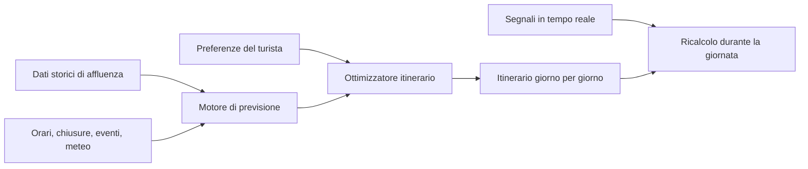

# Roma Senza Code
### Il tuo itinerario a Roma, costruito sui flussi reali di persone

> **One-liner:** un'app che conosce in anticipo quando il Colosseo, la Fontana di Trevi o i Musei Vaticani saranno affollati, e costruisce per te l'itinerario che ti fa vedere di più facendo meno fila.

---

## 1. Il problema

Roma è una delle città più visitate al mondo, ma visitarla bene è difficile.

- **Il tempo si perde in coda, non davanti ai monumenti.** Un turista medio resta a Roma pochi giorni e ne passa una parte consistente in fila o tra la folla, spesso negli stessi luoghi alla stessa ora degli altri.
- **Tutti seguono lo stesso copione.** Guide, blog e itinerari "Roma in 3 giorni" mandano le persone negli stessi posti negli stessi orari, alimentando i picchi di affollamento.
- **Le informazioni ci sono, ma sono sparse.** Orari, prenotazioni obbligatorie, giorni di chiusura, eventi, meteo e affollamento sono distribuiti su decine di siti diversi. Nessuno li mette insieme per decidere *quando* andare *dove*.
- **Le app esistenti dicono cosa vedere, non quando.** Mappe e guide indicano i luoghi e il percorso, ma non ottimizzano l'ordine della visita rispetto alla folla prevista.
- **Il sovraffollamento danneggia anche la città.** Concentrazioni eccessive in pochi punti peggiorano l'esperienza del visitatore, la vivibilità per i residenti e la conservazione del patrimonio.

**In sintesi:** il turista ha poco tempo, la città ha troppa gente negli stessi posti alle stesse ore, e manca uno strumento che usi i dati per distribuire meglio le visite.

---

## 2. La soluzione

**Roma Senza Code** è un pianificatore di viaggio intelligente che:

1. **Conosce i flussi storici** di monumenti, musei, piazze e luoghi di interesse: per ogni luogo, quanto è affollato per giorno della settimana, fascia oraria, stagione e in presenza di eventi.
2. **Chiede al turista poche cose:** date del viaggio, dove alloggia, cosa vuole assolutamente vedere, ritmo preferito (rilassato o intenso), interessi (arte, storia antica, cibo, quartieri autentici).
3. **Genera un itinerario ottimizzato** giorno per giorno, che ordina le visite per evitare i picchi, riduce gli spostamenti a piedi e con i mezzi, e rispetta orari di apertura e prenotazioni obbligatorie.
4. **Si adatta in tempo reale:** se piove, se un luogo è più pieno del previsto o se il turista è in ritardo, l'app ricalcola il resto della giornata.
5. **Suggerisce alternative di valore:** quando un luogo è al massimo dell'affollamento, propone un'alternativa vicina e meno nota, così il tempo diventa scoperta invece che attesa.

### Esempio concreto
> Invece di arrivare alla Fontana di Trevi alle 15:00 insieme a tutti gli altri, l'app ti manda lì alle 8:00 mentre vai verso il Pantheon, sposta i Musei Vaticani al pomeriggio di un giorno infrasettimanale con flussi più bassi, e mette il Colosseo nella prima fascia del mattino con biglietto già prenotato.

---

## 3. Come funziona

- **Motore di previsione dell'affollamento:** per ogni luogo stima il livello di folla per fascia oraria, partendo dai dati storici e correggendo per stagione, festività ed eventi.
- **Ottimizzatore dell'itinerario:** risolve un problema di pianificazione (simile al "problema del commesso viaggiatore con finestre temporali") che minimizza attese e spostamenti e massimizza i luoghi visti.
- **Ricalcolo dinamico:** durante la giornata riordina le tappe rimanenti in base a ritardi, meteo e affollamento osservato.

### Fonti dati possibili (da validare)
- Dati di affluenza e bigliettazione resi disponibili da musei, parchi archeologici e Comune, anche tramite accordi di partnership.
- Indicatori pubblici di "orari di punta" dei luoghi presenti nei servizi di mappe.
- Calendari di eventi, festività, giornate a ingresso gratuito e chiusure straordinarie.
- Meteo e dati sul trasporto pubblico.
- Dati anonimi raccolti dall'app stessa man mano che cresce la base utenti.

---

## 4. Per chi è

- **Turista principale:** visitatori di 2-5 giorni, alla prima o seconda volta a Roma, che vogliono vedere i luoghi iconici senza perdere tempo.
- **Famiglie e anziani:** per loro le code lunghe sono un problema concreto, non solo una seccatura.
- **Viaggiatori "esperienziali":** chi vuole evitare la folla e scoprire anche la Roma meno battuta.
- **In un secondo momento (B2B):** hotel, B&B e agenzie che vogliono offrire ai clienti un itinerario personalizzato come servizio.

---

## 5. Perché ora

- I visitatori pianificano sempre più il viaggio dallo smartphone e si aspettano strumenti personalizzati.
- Molti luoghi di Roma richiedono già prenotazione con fascia oraria: il viaggio va pianificato in anticipo, e l'ordine delle visite conta più che mai.
- Le città d'arte cercano strumenti per distribuire meglio i flussi turistici: l'app è allineata con questo obiettivo pubblico.
- Le tecnologie di previsione e ottimizzazione, insieme agli assistenti AI conversazionali, permettono oggi di offrire questo servizio a basso costo.

---

## 6. Vantaggio competitivo

| | Guide e blog | App di mappe | Tour operator | **Roma Senza Code** |
|---|---|---|---|---|
| Dice cosa vedere | Sì | In parte | Sì | Sì |
| Ottimizza *quando* andare | No | No | In parte | **Sì** |
| Usa i flussi storici di affluenza | No | Parziale | No | **Sì** |
| Si adatta in tempo reale | No | Parziale | No | **Sì** |
| Personalizzato sul singolo turista | No | No | Poco | **Sì** |

Il vantaggio cresce nel tempo: più utenti usano l'app, più dati di affluenza raccogliamo e più le previsioni diventano precise.

---

## 7. Modello di business

- **Freemium:** itinerario base gratuito per un giorno; itinerario completo multi-giorno e ricalcolo in tempo reale a pagamento (acquisto singolo per viaggio).
- **Commissioni di affiliazione:** su biglietti, visite guidate ed esperienze prenotate dall'app.
- **Partnership B2B:** licenza per hotel, B&B e agenzie di viaggio.
- **Dati aggregati e anonimi** per enti pubblici e gestori di siti culturali, utili alla gestione dei flussi.

---

## 8. Roadmap

1. **Prototipo (ora):** app dimostrativa su un set di 10-15 luoghi iconici di Roma, con dati di affluenza di esempio e generazione dell'itinerario.
2. **Video pitch:** una demo animata che mostra il percorso del turista, dall'inserimento delle preferenze all'itinerario ottimizzato.
3. **MVP:** dati reali per i principali luoghi, prenotazione biglietti integrata, test con i primi turisti.
4. **Crescita:** estensione ad altre città d'arte italiane (Firenze, Venezia, Napoli) e accordi B2B.

---

## 9. La richiesta

Cerchiamo partner, mentori e un primo finanziamento per passare dal prototipo all'MVP: accesso a dati di affluenza reali, sviluppo dell'app e primi test sul campo a Roma.

---

*Nota: questo documento è una prima bozza di pitch. Dati di mercato e numeri di affluenza vanno raccolti e verificati prima della presentazione a investitori.*
